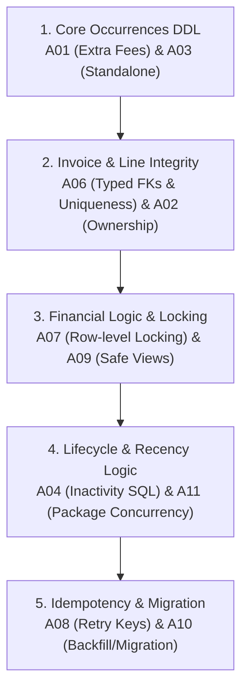

# Module 2 Master Unresolved & Engineering Audit Register

**Last Updated:** 6 November 2026  
**Baseline Authority:** Module 2 Decisions through S37 ([`packages.md`](packages.md), [`payments-and-settlement.md`](payments-and-settlement.md), [`checkout-and-invoice-lines.md`](checkout-and-invoice-lines.md), [`clinical-records.md`](clinical-records.md), [`examination-fees.md`](examination-fees.md), [`service-catalog-and-branch-pricing.md`](service-catalog-and-branch-pricing.md), [`reconciliation-2026-10-27.md`](reconciliation-2026-10-27.md), and [`clinic_module2_checkout_payments_voiding_addendum_2026-10-25_164648_IST.xlsx`](clinic_module2_checkout_payments_voiding_addendum_2026-10-25_164648_IST.xlsx)).

---

## Executive Summary

As of 5 November 2026 (incorporation of S34–S37 and complete clearance of `upcoming/`):
- **Commercial & Business Decisions:** **100% Locked.** There are **zero** open business review questions (`User-review rows = 0` in the decision tracker). All policies regarding package lifecycles, 10→26 upgrades, calendar return fees, payment methods, settlement waivers, invoice line integrity, and catalog immutability (`D01`) are settled.
- **What Remains Open:** Pure technical implementation engineering tasks, legacy schema checks, and post-MVP feature deferrals.

This document serves as the single central reference for all outstanding items across Module 2, divided into four non-overlapping categories:
1. [Category A: Technical Implementation Audits](#category-a-technical-implementation-audits-audit-required) (10 active engineering tasks)
2. [Category B: Legacy Schema Dispositions](#category-b-legacy-schema-dispositions) (4 unverified database prototype tables/fields)
3. [Category C: Parked Minor Behaviors](#category-c-parked-minor-behaviors) (2 operational edge cases parked for post-launch review)
4. [Category D: Post-MVP Feature Backlog](#category-d-post-mvp-feature-backlog-deferred-scope) (8 features deliberately excluded from MVP)

---

## Category A: Technical Implementation Audits (`AUDIT REQUIRED`)

> [!NOTE]
> These items do **not** represent missing business policy. The clinical and commercial rules are settled. These are engineering follow-up tasks for PostgreSQL DDL, database integrity constraints, row-level concurrency locking, RPC transactions, and API retry idempotency.

| ID | Issue / Ref | Owning Topic | Settled Business Rule | Technical Audit & Implementation Required |
|---|---|---|---|---|
| **`A01`** | `N41` `R15, R19, R69` *(O02, D-27)* | [Examination Fees](examination-fees.md) | First attendance is ₹350; calendar return gap 0–9 days is ₹0, 10–29 days is ₹150, 30+ days is ₹350. Fee-only checkouts (first or recurrent) require no clinical examination record, `visit_id`, or dummy therapy visit. One fee per physical encounter. | Design dedicated `extra_fees` table (or invoice line source tuple). Ensure foreign key structure allows invoice lines to reference fees without requiring a `visit_id` or `visit_services` row. Verify composite constraints prevent duplicate fees on the same calendar day. |
| **`A02`** | `N42` `R67` *(O13, O15)* | [Clinical Records](clinical-records.md) | Multi-entity checkouts span patient, clinic, complaint course, visits, standalone treatments, and invoices. Authenticated backend identity governs; React client cannot supply arbitrary IDs. | Audit schema-wide reference keys: determine which entity IDs must be explicitly stored vs derived via joins. Implement composite foreign keys / triggers enforcing that `visit.patient_id == complaint.patient_id == invoice.patient_id`. Ensure API rejects missing or contradictory client IDs. |
| **`A03`** | `N43` `R27–R29, R82` *(O11, D-32)* | [Clinical Records](clinical-records.md) | Standalone treatments are independently billable occurrences with mandatory anatomical body region. They store `service_id` and join to the catalog for display name (no copied name snapshot). They do not link to complaint courses. | Draft DDL for `standalone_treatments`. Decide physical storage of `body_regions` (PostgreSQL `enum` vs lookup table). Implement foreign key to `services(id)`. Audit recorder/timestamp conventions (`recorded_by`, `performed_at`). |
| **`A04`** | `N44` `R15–R17, R20` *(O03, O14)* | [Examination Fees](examination-fees.md) | Inactivity is measured in calendar days since the patient's most recent qualifying completed attendance (therapy-only or fee-only resets the clock). Evaluated automatically by backend inside Create Invoice transaction before issuance. | Write the SQL query / stored procedure calculating calendar gap: handle clinic timezone (`Asia/Kolkata`) vs UTC storage; ensure same-day checkouts recognize earlier visits today; prevent concurrent checkouts from racing on first-attendance fee. |
| **`A06`** | `N46` `R19, R31–R35` *(O07, O13)* | [Checkout & Invoices](checkout-and-invoice-lines.md) | Exactly one logical billable source per invoice line (`visit`, `standalone_treatment`, `extra_fee`, `package_purchase`). Covered visits receive explicit zero-amount lines. Billing the same physical occurrence twice across invoices is strictly forbidden. | Implement database `CHECK` constraint enforcing mutual exclusivity across nullable source FKs (`visit_id`, `standalone_id`, `fee_id`, `package_id`). Add partial unique indexes to guarantee each source occurrence is referenced by at most one invoice line. |
| **`A07`** | `N47` `R36–R56, R80` *(O09, O15)* | [Payments & Settlement](payments-and-settlement.md) | Four states (`UNPAID`, `PARTIALLY_PAID`, `PAID`, `WAIVED`). Cash/UPI only; split tender saves separate payment rows. Only admin may waive residual; terminal states are immutable. Admin-only MVP launch; reception permissions follow post-MVP. | Implement row-level locking (`SELECT FOR UPDATE` on `invoices`) during payment and waiver settlement to eliminate concurrent overcollection races. Write PostgreSQL trigger enforcing immutability on terminal invoices and payment rows. Draft RLS policies for admin vs future reception roles. |
| **`A08`** | `N48` `R60, R61` *(O14, D-24)* | [Checkout & Invoices](checkout-and-invoice-lines.md) | Double-submission prevented by client button disabling and backend idempotency. Rolling back failed writes preserves UI form for manual retry. Lost network responses must be safely verifiable without duplicate billing. | Design idempotency mechanism: request hashing, stable operation key (`client_request_id`), server-side outcome caching, replay detection, and recovery endpoints for checking transaction status after network timeout. |
| **`A09`** | `N49` `R41, R46, R54, R57` *(O14, O16)* | [Payments & Settlement](payments-and-settlement.md) | Financial amounts derived: `billed = sum(lines)`, `received = sum(payments)`. When `WAIVED`, `forgiven = billed - received` and `outstanding = 0`. No redundant stored total columns. Collection reports sum positive receipts by `received_at` date. | Write SQL view or stored functions for invoice balances that avoid Cartesian join multiplication between child lines and payments. Add indexes on `payments(received_at)` and `invoices(clinic_id, status)`. Audit timezone boundary handling in daily collection reports. |
| **`A10`** | `N50` `R66, R71, R72` *(O17, O18)* | [Decision Register](reconciliation-2026-10-27.md) | Target model uses immutable lines, separate payment rows, and 4 clean statuses. Legacy prototype tables used older `amount_in_paise`, single `visit_id`, and `Pending/Due` ledger statuses. | Compare existing repository migration scripts with settled target DDL. Formulate data migration/backfill plan for existing development environments. Build end-to-end integration test suite verifying atomic checkout and settlement. |
| **`A11`** | `N51` `R62` *(O08, S34–S37)* | [Packages](packages.md) | Package business rules are locked: 10-visit base, 26 max (+16 upgrade), Day-30 review anchor, daily cap copied from parent, $\max(0, P_{26} - P_{10})$ pricing floored at zero, terminal parent, one upgrade finality, payment-independent activation. | Audit database concurrency protections for package entitlement redemption: prevent race conditions on the 10th visit unit under concurrent checkouts; prevent double-upgrade submissions; enforce server-controlled upgrade price calculations and review date anchors. |

---

## Category B: Legacy Schema Dispositions

> [!NOTE]
> These tables and columns were identified in early schema drafts (the October 25 16-table audit) but are either unconfigured or lack active product requirements for Module 2 MVP.

| Issue | Entity / Column | Historical Note | Required Action |
|---|---|---|---|
| **`N09`** | `patient_vitals` | Vitals recording feature was deferred from MVP launch scope. | Check repository migrations and live database: decide whether to physically drop `patient_vitals` or leave it dormant/unexposed in UI. |
| **`N10`** | `patient_alerts` | Removal intent was documented; alert generation was not approved for Module 2. | Verify whether existing frontend code or other modules reference `patient_alerts` before removing the table. |
| **`N11`** | `timeline_events` | Prototype generic event logging table with optional visit/note FKs. | Inspect actual database usage: evaluate whether it duplicates `visits` and `clinical_notes`, or should be retired in favor of direct entity queries. |
| **`N23`** | `visit_services` creator metadata | Early schema gap noted missing `created_by` / `created_at` timestamps on procedure junction rows. | Audit `visit_services` DDL to ensure server defaults (`created_at TIMESTAMPTZ NOT NULL DEFAULT now()`) and performer/creator attribution exist. |

---

## Category C: Parked Minor Behaviors

> [!NOTE]
> Minor workflow edge cases that were explicitly parked because they do not block launch and will be finalized using operational feedback from live clinic practice.

| Issue | Topic | Context & Current Working Default | Reopening / Resolution Trigger |
|---|---|---|---|
| **`A05` / `N45`** | Complaint Lifecycle Inactivity | When a patient stops attending for an extended period, does an old complaint course ever automatically transition to "Inactive" or "Closed"? **Current default:** Complaints remain active indefinitely; no automated closure occurs without explicit clinician action. | Revisit post-launch based on clinical record volume and doctor feedback on whether long-abandoned complaints clutter selection menus. |
| **`A13` / `N53`** | Frontend Procedure Deselection Cleanup | In the checkout UI, if a clinician selects Complaint B, selects several bundled or standalone procedures, and then unchecks Complaint B before submitting: what happens to the selected procedures? **Current default:** Frontend form state discards or clears procedures linked to deselected complaints prior to submission. | Finalize during frontend component implementation and validation of the procedure logger form state. |

---

## Category D: Post-MVP Feature Backlog (Deferred Scope)

> [!NOTE]
> These capabilities were discussed during design sessions and explicitly deferred beyond MVP. They are documented here to prevent scope creep during MVP development and to preserve architectural foresight for future modules.

| Feature / Topic | Relevant Issues | Reason for Deferral & Preserved Architectural Direction |
|---|---|---|
| **Multi-branch Catalog Pricing** | `R03`, `O06` | Launch operates a single clinic. Multi-branch sparse pricing overrides (`clinic_services`) are deferred until Branch 2 is onboarded. |
| **Patient-specific Negotiated Rates** | `R06`, `O12` | No persistent negotiated rate engine in MVP. Discretionary discounts are handled transparently at checkout via standard catalog invoice lines followed by an authorized admin settlement waiver (`WAIVED`). |
| **Retail Products, Consumables & Stock** | `O01` | Physical product sales, inventory management, and stock returns are excluded from clinical checkout in Module 2. |
| **Retroactive Clinical Voiding & Deletions** | `N01`–`N08`, `R30` | Care occurrences and clinical history are immutable in MVP. No physical deletion or retroactive soft-delete cascade is built at launch. |
| **Retroactive Invoice Appends & Repricing** | `N12`, `R63` | Invoices cannot be amended, repriced, or appended after issuance. Corrections must be handled through standard settlement workflows. |
| **Patient Credit Wallets & Unallocated Balances** | `O21`, `R45` | Every payment row belongs to exactly one invoice. No patient credit balances, unallocated customer deposits, or inter-invoice fund transfers exist in MVP. |
| **Automated Old-Debt Chasing & Cross-Allocation** | `N25`, `R39` | Needs Attention displays due invoices sorted by balance descending. No automated WhatsApp/SMS debt chasing or automatic cash allocation across separate invoices. |
| **Receptionist Operational Role & Custom RLS** | `R38`, `R40`, `S24`, `S37` | Launch operates with Admin as the sole user role. The dedicated Receptionist role (initial/later payments permitted, waivers strictly forbidden, package debt gating enforced) will be implemented in a subsequent post-MVP security update. |

---

## Recommended Sequence for Resolving Category A (Engineering Audits)

When transitioning to technical execution, address the Category A audits in this logical dependency order:

1. **Step 1 — Core Occurrences DDL:** Resolve **`A01`** (independent extra fees table) and **`A03`** (standalone treatments table & body regions).
2. **Step 2 — Invoice Line Constraints:** Resolve **`A06`** (typed source FK constraints) and **`A02`** (composite patient/clinic ownership).
3. **Step 3 — Settlement Integrity:** Resolve **`A07`** (concurrency locking during payments/waivers) and **`A09`** (safe balance views avoiding join duplication).
4. **Step 4 — Business Calculation Functions:** Resolve **`A04`** (attendance recency SQL) and **`A11`** (package unit concurrency locking).
5. **Step 5 — API & Migration Packaging:** Resolve **`A08`** (request idempotency hashing) and **`A10`** (migration review against legacy schema).
